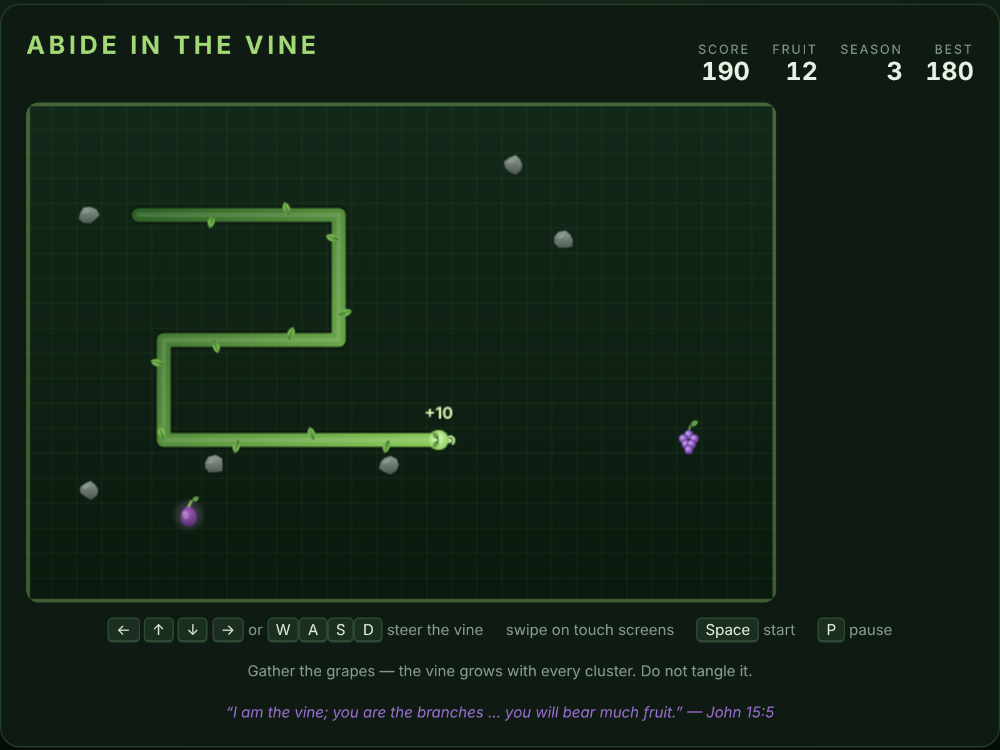

# Abide in the Vine

*"I am the vine; you are the branches. If you remain in me and I in you, you
will bear much fruit; apart from me you can do nothing."* — John 15:5

Steer the growing tip of a vine around a walled garden and gather grape
clusters. Every cluster you gather makes the vine longer, so the garden fills up
as you do well — run the tip into the garden wall, a trellis stone or your own
stem and the vine is tangled, and the run is over.

## How to play

Open `index.html` in any browser — no build step or server required.

- **Steer** with the **arrow keys** or **WASD**. On a touch screen, **swipe** on
  the garden.
- **Start** a run with **Space**, **Enter**, any steering key, or the Start
  button.
- **Pause / resume** with **P**. Switching to another tab pauses the run for you.

The vine never stops moving, and it cannot turn back on itself — you can only
turn left or right of the way it is already growing.

## Goal

Gather as much fruit as you can before the vine tangles.

| Fruit | Worth | Effect |
|---|---|---|
| Grape cluster | 10 points | The vine grows 3 cells longer and speeds up a little |
| Fig (bonus) | 50 points | No growth — it appears every fourth cluster and does not wait long |

Every five clusters starts a new **season**: two more trellis stones are set in
the garden, and they are as solid as the wall. Stones never appear right in
front of the tip, so a new season can never kill you on its own.

The vine speeds up with every cluster, from 150 ms a cell down to a floor of
85 ms, so late seasons are long, fast and crowded. Fill the whole garden with
vine and you win outright — *much fruit*.

Your best score is kept in the browser between visits.

## Files

| File | What it is |
|---|---|
| `index.html` | Page, HUD, canvas and overlay |
| `style.css` | Styling |
| `game.js` | The whole game: model, rules, rendering, input |
| `DESIGN.md` | How the code works, and the assumptions behind it |
| `tests/` | Playwright tests (`npx playwright test AbideInTheVine/tests/`) |
