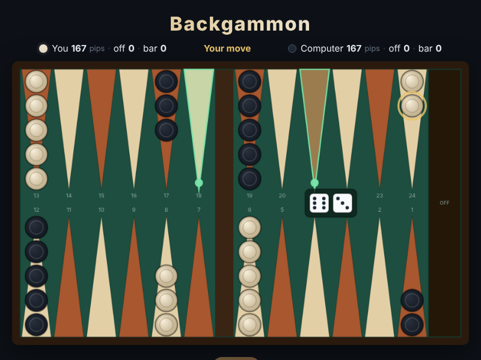

# Backgammon

The oldest board game still in play, on an HTML5 canvas: a race around
twenty-four points where both sides run in opposite directions, the dice decide
how far you may go, and a checker left alone can be sent all the way back to the
start. You play the light checkers; the computer plays the dark ones.

Open `index.html` in any browser — no build step, no server.

## How to play

1. Press **Roll**. Two dice give you two moves; doubles give you four.
2. **Click one of your checkers**, and every point it can reach lights up green.
   **Click a lit point** to move there.
3. You run **downhill** — from point 24 towards point 1 — and bear off past
   point 1. The computer runs the other way.
4. You may land on an empty point, on a point of your own, or on a point holding
   a **single** enemy checker, which is then **hit** and goes to the bar. A point
   with two or more enemy checkers is shut to you.
5. A checker on the bar must **re-enter** in the opposite home board before you
   may move anything else: click the bar, then a lit point. Your entry point is
   `25 − die`, so a 3 enters on point 22.
6. Once all fifteen of your checkers are home — points 1 to 6 — you may **bear
   off**: click a checker and then the tray on the right edge. An exact die
   always bears off; a bigger die bears off only when you have nothing further
   back.
7. A die with no legal move anywhere is lost, and a roll with no legal move at
   all passes the turn.
8. **First player to bear off all fifteen checkers wins.** If the loser has borne
   off nothing it is a *gammon*, and if they are also still on the bar or stuck
   in the winner's home board it is a *backgammon*.

The pip count in the header is the honest measure of who is ahead: it is how
many pips that side still has to travel.

| Input | Action |
|---|---|
| **Roll** button, or `Space` / `Enter` | Roll the dice |
| Click your point | Pick a checker up (legal destinations light up) |
| Click a lit point | Move there |
| Click the bar | Pick up the checker you must re-enter |
| Click the tray on the right | Bear off |
| Click the same point again | Put the checker back down |
| `R` | Restart |

## The computer

The computer searches every order in which it could play its dice and keeps the
one that leaves it best off: ahead on the race, with its checkers borne off, with
you on the bar, with points of its own made, and without blots standing out in
your home board. It looks one move deep, so it plays a sound race and will
punish a loose checker, but it never plans two rolls ahead — a blocking game
will beat it.

## Notes

There is **no doubling cube**, no stake and no score carried between games: each
game is a single game played for nothing.

See [DESIGN.md](DESIGN.md) for how the code is laid out, and
`tests/backgammon.spec.js` for the Playwright suite — including a test that
plays a whole game out to a win and checks every checker is still accounted for.
