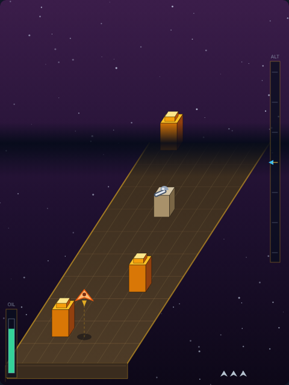

# Chariot of Fire

*"The hills were full of horses and chariots of fire."* — 2 Kings 6:17

Ride a chariot of fire over a stronghold of idol worshippers. The city slides
past beneath you, and the one thing that decides everything is your
**altitude**: your fire flies level, at exactly the height you are riding, so an
idol altar on the ground can only be toppled from low down — and low down is
where the stronghold can hurt you.



## How to play

1. Press **Space**, or click **Start Game**.
2. Steer across the city with **←/→** or **A/D**.
3. Climb and dive with **↑/↓** or **W/S** — watch the **ALT** ladder on the
   right, and the shadow under your chariot.
4. Hold **Space** to fire.
5. Ride through the gate in each city wall, topple the great idol of Dagon at
   the end of the city, and do it four times.

Your oil is always burning down. The only refill is an **oil jar** on the
ground (like the widow's jar that never ran dry, 2 Kings 4), and the only way to
reach one is to drop down to its height — which is the whole bargain the game
offers you.

## Targets and points

| Target | Points | Notes |
|---|---|---|
| Oil jar | 150 | returns 30 oil — your only way to top up |
| Idol altar | 200 | hurls fire at wherever you are, so keep moving |
| Enemy chariot | 300 | cruises at a fixed height; match it to hit it |
| City wall | — | cannot be knocked down; ride through the gate |
| Idol of Dagon | 2000 | six hits, and the city is free |

Clearing a city pays **1000 plus 10 per unit of oil** still in the jar, so
arriving at the idol with a full supply is worth as much as a handful of altars.
Three chariots, four cities, and your best score is remembered between sessions.

## Controls

| Input | Action |
|---|---|
| `←` `→` / `A` `D` | steer across the city |
| `↑` `↓` / `W` `S` | climb and dive |
| `Space` (tap or hold) / click | start, fire, or dismiss an overlay |
| `P` | pause and unpause |

## Tips

- The dotted line to your shadow is the honest read on your height; the sprite
  alone is ambiguous.
- An idol altar hurls fire at where you *are*, not where you are going. Drifting sideways
  or climbing even slightly as the shot flies is enough to make it miss.
- Walls come in two flavours: a gate low down means dive, a gate high up
  means climb. Commit early — the chariot has to fit through whole.
- Hit the oil jars you pass even when the gauge looks healthy. The next
  chance may be on the far side of a wall.
- Against the idol, level out around mid-height: its hitbox covers most of the
  deck, so you can fire while still having room to dodge.

## Files

- `index.html` — page shell, HUD, canvas and overlay
- `style.css` — cabinet styling
- `game.js` — simulation, isometric projection and rendering
- `DESIGN.md` — how the game works internally, and the assumptions behind it
- `tests/chariot-of-fire.spec.js` — Playwright suite

Run the tests from the repository root:

```powershell
npx playwright test ChariotOfFire/tests/
```
