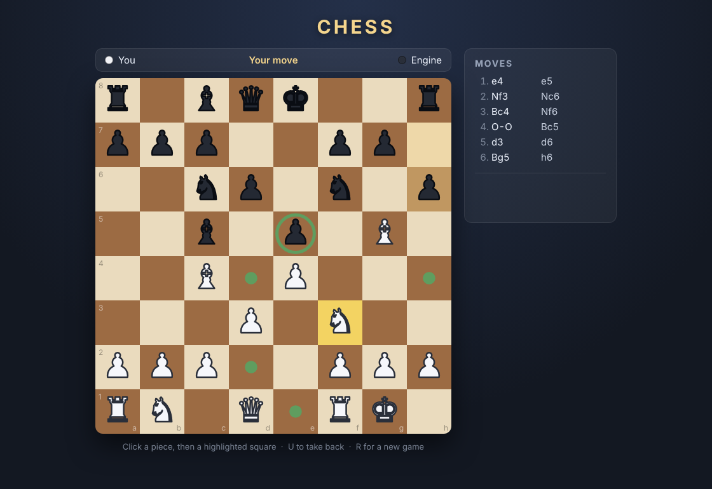

# Chess

The whole game of chess against a built-in engine, on an HTML5 canvas with no
build step and no dependencies. You play White; the engine answers as Black.



## How to play

1. Open `index.html` in any modern browser — no server, no install.
2. Press **Start Game** (or **Space**) to begin.
3. Click one of your pieces. Its legal moves appear as green dots, and a green
   ring marks a piece you can capture.
4. Click one of those squares to move. The engine replies after a moment.

### Controls

| Input | Action |
|---|---|
| Click a piece, then a highlighted square | Make a move |
| Click the same piece again | Deselect |
| Promotion buttons | Choose queen, rook, bishop or knight |
| `U` | Take back your move and the engine's reply |
| `R` | New game |
| `Space` | Start |

## What is implemented

Every rule an ordinary game needs:

- all six pieces, with sliding pieces blocked properly;
- **castling** on both wings, refused after the king or that rook has moved,
  while in check, or through or onto a square the opponent attacks;
- **en passant**, available only on the ply right after the double push;
- **promotion** to any of the four pieces — the engine may under-promote too;
- **check**, **checkmate** and **stalemate**;
- draws by the **fifty-move rule**, **threefold repetition** and **insufficient
  material**.

The move generator is checked against the five standard `perft` positions — the
leaf counts of the move tree at depths 1–3 — so the awkward cases (en-passant
discoveries, castling through check, promotion captures) are pinned down rather
than assumed.

Moves are listed beside the board in standard algebraic notation, with the
proper disambiguation (`Nbd2`, `R1a3`) and `+` / `#` for check and mate.
Captured pieces are shown under the move list.

## The engine

A 3-ply alpha-beta search with a captures-only quiescence search on top, so it
does not stop counting in the middle of a trade. It judges a position by
material, a piece-square table for each piece type (with a separate king table
for the endgame) and a bonus for the bishop pair. It answers in well under a
second and plays a sound beginner's game: it will take your hanging pieces,
spot a mate in one and sidestep a back-rank mate.

Exact ties are broken at random, so two games do not open the same way.

## Tests

Playwright drives the real page. From the repository root:

```powershell
npx playwright test Chess/tests/
```

The suite covers the FEN reader and writer, every piece's movement, pins,
castling in all its refusals, en passant, promotion, mate, stalemate and the
three draws, algebraic notation, perft, the clicking interface, undo, restart
and the engine's choices.

## Files

| File | Contents |
|---|---|
| `index.html` | Canvas, HUD, overlays, move list |
| `style.css` | Layout and theme |
| `game.js` | Rules, notation, engine, rendering, input |
| `DESIGN.md` | How the code works, and the assumptions behind it |
| `tests/chess.spec.js` | The Playwright suite |

## A note on the theme

The repository prefers a wholesome Christian theme where a game can carry one.
Chess is a classic board game whose rules are the point, so it is left unthemed
— as the content policy allows for classic board and card games.
