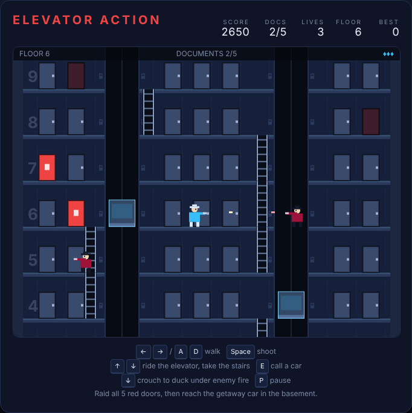

# Elevator Action

You are a spy dropped onto the roof of an enemy ministry. Somewhere below are
secret documents behind **red doors**; the getaway car is parked in the lobby.
Between the two are a dozen floors of elevators, locked-off shafts and agents
who shoot on sight.

## How to play

1. Press **Space**, or click **Start Game**.
2. Walk along a floor with **←/→** (or **A/D**). Standing next to a red door
   takes its documents automatically.
3. A shaft is a hole in the floor: you can only cross it, or ride it, when a car
   is level with you. Leave an idle car alone and it comes to the floor you are
   standing on.
4. Standing on a car, **↑/↓** (or **W/S**) drives it — but only within the
   floors that shaft serves. The plate at the top of each shaft says which
   floors those are.
5. Collect every document, then ride down to the lobby and walk into the
   **getaway car** on the right. The car stays locked while any document is
   still in the building.

Three lives, four buildings, each taller than the last.

## Agents

Agents step out of the grey doors and walk toward you, firing when you share a
floor. Two ways to deal with them:

| Method | Points |
|---|---|
| Shoot them with **Space** | 300 |
| Drop an elevator car on them | 800 |

Riding between floors keeps you out of their line of fire — they never use the
elevators themselves.

## Scoring

| Event | Points |
|---|---|
| Document collected | 500 |
| Agent shot | 300 |
| Agent crushed by a car | 800 |
| Building cleared | 1000 + 250 per life in hand |

Your best score is remembered between sessions.

## Controls

| Input | Action |
|---|---|
| `←` `→` / `A` `D` | walk |
| `↑` `↓` / `W` `S` | drive the elevator you are standing on |
| `Space` | shoot, or start / dismiss an overlay |
| `P` | pause and unpause |

## Tips

- Check a shaft's service plate (`3-7`, `0-4`) before you commit to it. No shaft
  runs the whole height, so getting down means transferring at least once.
- A car you are not in drifts toward your floor. Walking to a shaft and waiting
  a moment is often faster than running for the one you can already see.
- An agent chasing you across a shaft opening is an agent standing under your
  car. Ride up, then come straight back down.
- Clearing a building pays 250 per life you still hold, so the cautious route is
  usually the higher-scoring one.

## Files

- `index.html` — page shell, HUD, canvas and overlay
- `style.css` — presentation
- `game.js` — the simulation and all rendering
- `DESIGN.md` — how the code works, and the assumptions behind the rules
- `tests/elevator-action.spec.js` — Playwright suite covering the rules
- `tests/bot.spec.js` — an autopilot that plays each building end to end

Run the tests from the repository root with `npx playwright test ElevatorAction/tests/`.
