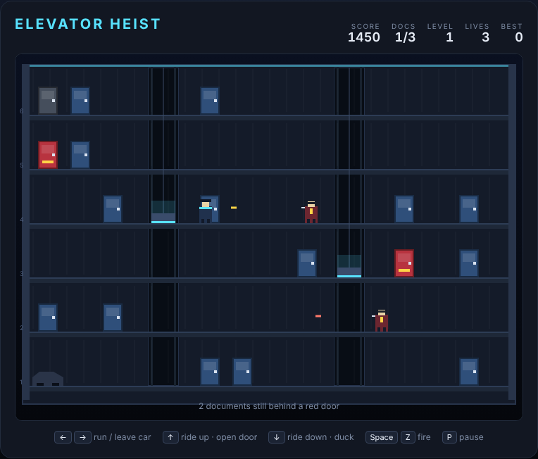

# Elevator Heist

A spy has broken into a high-rise archive. Loot every **red door**, then reach
the **getaway car** at the left end of the ground floor — while building
security walks out of the blue doors and shoots at chest height.

There are no stairs. The only way between floors is one of the two elevator
cars, and each car stays wherever it was last left, so half the game is routing
yourself through the shafts.



## Playing

Open `index.html` in any browser. No build step, no server.

## Controls

| Key | Action |
|---|---|
| `←` `→` | run along the floor, or step off a car onto a floor |
| `↑` | board a level car, ride it up, or open the door you are standing on |
| `↓` | board a level car, ride it down, or duck |
| `Space` / `Z` | fire |
| `P` | pause |
| `Space` | start a new game from the title or game-over screen |

`A` `D` `W` `S` work as well as the arrow keys.

## How it plays

- **Documents.** Red doors hold the level's classified documents. Stand in front
  of one and press `↑` to take it (`+250`). The HUD's *Docs* counter shows how
  many are left. Blue doors are empty — and they are where security comes from.
- **Elevators.** Walk into a shaft. If that shaft's car is level with your
  floor, `↑` or `↓` puts you inside it; after that `↑`/`↓` drive the car and
  `←`/`→` step you off, but only when the car is level with a floor. A car that
  comes down on an agent standing in the shaft flattens it (`+150`).
- **Agents.** They pause in the doorway as they emerge, then close in along
  whatever floor they are on and fire at chest height (`+100` to shoot one
  first). They never ride the elevators, so riding away from a floor is always
  an escape.
- **Ducking.** `↓` on an open floor drops you below the line of fire — agent
  bullets pass overhead. You cannot move while ducked.
- **Escaping.** Once every document is taken, the getaway car at the bottom-left
  lights up. Reach it to clear the level (`+500`, plus `+100` per floor).

You have three lives. Losing one puts you back on the top floor but **keeps**
the documents you already took. Best score is kept in `localStorage`.

## Levels

Levels are generated from a seed derived from the level number, so level *n* is
always the same building. They grow from 6 floors / 3 documents / 2 agents up to
9 floors / 6 documents / 5 agents, and agents get faster and quicker on the
trigger as you climb.

## Development

`DESIGN.md` explains the code. The game is one classic
(non-module) script so the Playwright specs can reach the state as globals;
everything is advanced through `step(dt)`, which makes the tests deterministic.

```powershell
npx playwright test ElevatorHeist/tests/
```
