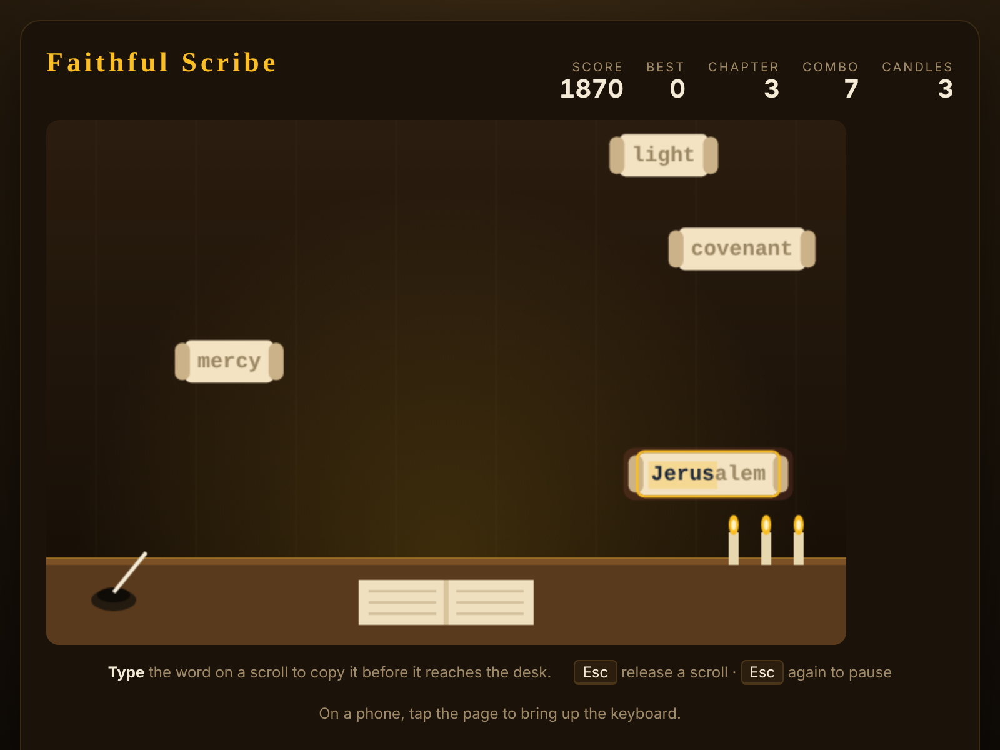

# Faithful Scribe

*"Take a scroll and write on it all the words I have spoken to you."* — Jeremiah 36:2

A typing arcade game on an HTML5 canvas — no build step, no dependencies. Scrolls
drift down through the scriptorium toward the scribe's desk, each carrying one
word of Scripture. Copy a scroll by typing its word before it lands. Every scroll
that reaches the desk un-copied snuffs out one of your candles, and when the last
candle goes out the day's work is over.



## How to play

Open `index.html` in any browser, press **Space**, and start typing.

| Input | Action |
|---|---|
| Letter keys | Copy the scroll you are working on, or start the lowest scroll beginning with that letter |
| <kbd>Esc</kbd> | Put a scroll down so you can start another |
| <kbd>Esc</kbd> again (with no scroll in hand) | Pause and resume |
| <kbd>Space</kbd> / <kbd>Enter</kbd> | Begin a new day from the title or end-of-day screen |
| Tap the board | Raises the keyboard on a phone or tablet |

Letters are matched whatever the case, so `Jerusalem` can be typed in lower case.

## The rules

- **Lock on.** Your first letter picks the lowest scroll that needs it — the one
  closest to the desk, which is always the one in most danger. The scroll is
  outlined in gold while you copy it.
- **Blots.** A wrong letter is a blot: your streak drops to zero, but the letters
  already copied stay on the scroll. Press <kbd>Esc</kbd> if you would rather
  save a different scroll first.
- **Score.** A finished word is worth ten points a letter, multiplied by your
  streak: the multiplier steps up every five words copied in a row, to a maximum
  of five. `righteousness` on a long streak is worth a lot of ink.
- **Chapters.** Eight words finish a chapter. Each chapter sends the scrolls down
  faster, more often, and with longer words — and lights one candle back, up to
  five.
- **Candles.** You start with three. A scroll glows red as it nears the desk;
  when it touches, a candle goes out. At zero the day ends and your best score is
  remembered in the browser.

## Files

| File | What it holds |
|---|---|
| `index.html` | The page: HUD, canvas, overlay and help text |
| `style.css` | The candlelit scriptorium styling |
| `game.js` | All of the game: state, simulation, typing and rendering |
| `DESIGN.md` | How the code is put together, and the assumptions behind it |
| `tests/` | The Playwright suite that was written before the game |

## Tests

From the repository root:

```powershell
npx playwright test FaithfulScribe/tests/
```
