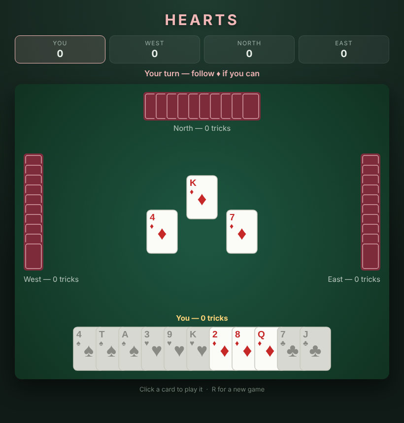

# Hearts

Four-handed Hearts against three computer players, on an HTML5 canvas — no
build step, no dependencies, no network. Every heart costs a point, the queen
of spades costs thirteen, and the player with the **fewest** points when
somebody reaches 100 wins.



## How to play

1. Open `index.html` in any browser.
2. Press **Start Game**.
3. At the start of most hands you pass three cards. Click three of your cards —
   they lift up — then press **Pass 3 cards**.
4. Whoever holds the two of clubs leads it. Follow the suit led if you can.
   Cards you may play stay bright; the rest are greyed out.
5. Click a card to play it. Take as few points as you can.

### Controls

| Input | Action |
|---|---|
| Click a card | Play it, or choose it for the pass |
| Click a chosen card again | Take it back out of the pass |
| `Space` | Start, confirm a pass, or go on to the next hand |
| `R` | New game |

## The rules used here

- The pass goes **left, right, across, then not at all**, and repeats.
- The **two of clubs** leads the first trick.
- You must **follow suit** if you can; highest card of the suit led takes the
  trick and leads the next.
- **No points on the first trick** — no heart and no queen of spades — unless a
  player holds nothing else.
- **Hearts must be broken**: hearts cannot be *led* until one has been played,
  unless the leader holds only hearts. The queen of spades may be led any time.
- Each heart scores 1 and the queen of spades 13, so a hand is worth 26.
- Take all 26 and you have **shot the moon**: the other three take 26 each.
- First player to 100 ends the game, and the **lowest** score wins.

There are no stakes of any kind — Hearts is scored on paper, and nothing is
wagered. As a classic card game whose rules are the point, it is left unthemed,
which the repository's content policy allows.

## The computer players

A documented heuristic, not a search — Hearts hides every other hand, so a deep
search would be false precision. They pass the queen of spades when she is
thinly guarded along with the high spades, lead low from short suits, play the
highest card that still *loses* a trick when following, and throw the queen or
a high heart when they are void. They see only their own cards.

## Tests

Playwright drives the real page. From the repository root:

```powershell
npx playwright test Hearts/tests/
```

The suite covers the deck and card values, the passing cycle in all four
directions, the lead, following suit, the first-trick and hearts-broken rules,
trick winners, scoring including shooting the moon, the hundred-point finish,
the computer players' legality and judgement, clicking cards, and ten whole
games played out from deal to final score.

## Files

| File | Contents |
|---|---|
| `index.html` | Canvas, scoreboard, overlay, pass button |
| `style.css` | Layout and theme |
| `game.js` | Rules, computer players, rendering, input |
| `DESIGN.md` | How the code works, and the assumptions behind it |
| `tests/hearts.spec.js` | The Playwright suite |
