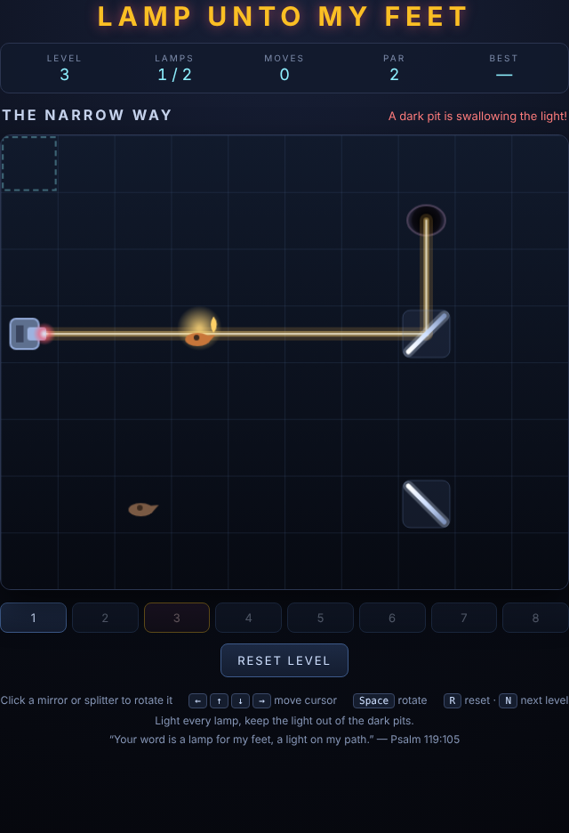

# Lamp unto My Feet

*"Your word is a lamp for my feet, a light on my path."* — Psalm 119:105

Turn the mirrors so one lamp's light reaches every oil lamp on the board — and
keep it out of the dark pits.



## How to play

The lamp on the board shines a single ray of light. Diagonal mirrors bend it 90°,
splitters cut it into two rays, walls stop it and dark pits swallow it. Each level
starts with the mirrors pointing the wrong way; flip them until the light runs
through **every** lamp at once.

- **Click** a mirror or splitter to flip it between `/` and `\`.
- **Arrow keys** move the keyboard cursor, **Space** flips the device under it.
- **R** resets the level, **N** moves on once you have solved it.
- The level strip under the board jumps to any level you have unlocked.

Devices sitting on a faint socket can be turned. Bare ones — the amber mirrors —
are fixed scenery, and so are walls, lamps and pits.

## Scoring

Every flip is a move. Each level shows a **par**: the fewest flips that can
possibly solve it. Matching par is the goal; your best run per level is kept in
the browser, along with how far through the eight levels you have reached.

## Levels

| # | Name | Par | What it introduces |
|---|---|---|---|
| 1 | A Lamp to My Feet | 1 | One mirror, one lamp |
| 2 | Turn Again | 2 | Two bounces to reach around |
| 3 | The Narrow Way | 2 | Dark pits, and lamps strung along one ray |
| 4 | Two Paths | 2 | Splitters |
| 5 | The Winding Road | 3 | A three-bounce circuit |
| 6 | Three Lamps | 2 | Two splitters, three lamps |
| 7 | The Wilderness | 3 | Fixed mirrors and walls |
| 8 | Let Your Light Shine | 3 | Everything at once, four lamps |

## Running it

Open `index.html` in any browser — no build step, no server.

## Tests

From the repository root:

```powershell
npx playwright test LampUntoMyFeet/tests/
```

The suite covers the light tracer rule by rule (reflection, splitting, walls,
pits, loop termination), the input and HUD, and the levels themselves: for each
level it brute-forces every mirror combination to prove the level is solvable
and that its published par really is the minimum.
