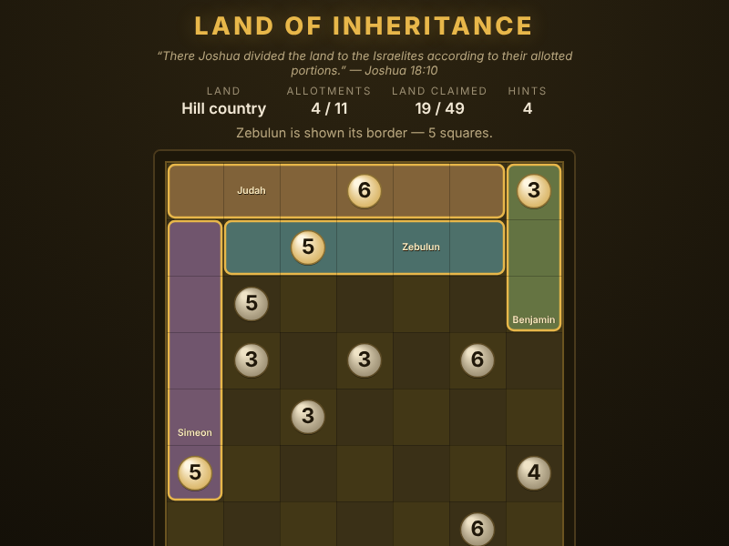

# Land of Inheritance

*"There Joshua cast lots for them in Shiloh before the Lord, and there he
divided the land to the Israelites according to their allotted portions."*
— Joshua 18:10

A logic puzzle on an HTML5 canvas. The land is spread out before you and the
boundary stones are already set; each one carries the number of squares in that
tribe's field. Mark out a rectangular field around every stone until the whole
land is divided and no square is left over.



## How to play

Open `index.html` in any modern browser — no build step, no server, no
dependencies.

### Controls

| Action | Mouse | Keyboard |
|---|---|---|
| Mark out a field | drag from corner to corner | **Space** on one corner, move, **Space** on the other |
| Cancel a half-made field | release on the square you started on | **Esc** |
| Clear a field | click or right-click inside it | **Backspace** / **Delete** |
| Move around the land | — | **arrow keys** or **WASD** |
| Hint | **Hint** button | **H** |
| New land | **New Land** button | **N** |
| Clear the whole land | **Reset** button | **R** |

### Rules

- Every field is a rectangle (or a square).
- A field must take in **exactly one** boundary stone.
- A field must hold **as many squares as the number** on its stone.
- Fields may never overlap, and when the land is divided every square belongs
  to one.

A field of the wrong size is allowed to stand while you think — it is drawn in
dashed red and does not count — so you can try an idea and clear it again. The
drag preview shows the running square count, and turns green the moment it
matches the stone inside it.

### The three lands

| Land | Grid | Largest field |
|---|---|---|
| Hill country | 7 × 7 | 6 squares |
| Shephelah | 9 × 9 | 8 squares |
| Beyond Jordan | 11 × 11 | 9 squares |

Every land is generated fresh, and always has **exactly one** lawful division —
there is a real answer to find, and no guessing is needed to reach it. Finish
one and the overlay leads you on to the next.

## Tests

Playwright covers the rules, the generator (coverage, field sizes, unique
solutions), mouse and keyboard play, the buttons and winning:

```powershell
npx playwright test LandOfInheritance/tests/
```
