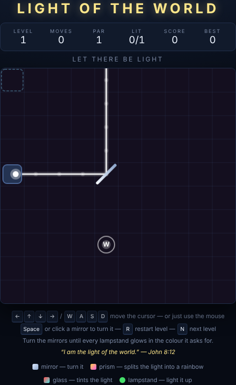

# Light of the World

*"I am the light of the world. Whoever follows me will never walk in darkness,
but will have the light of life."* — John 8:12

A lamp shines into a grid of mirrors, prisms and coloured glass. Turn the
mirrors until every lampstand on the board glows in the colour it is asking
for. A prism splits the light into the colours of the rainbow.

Nothing moves on its own, nothing is on a timer, and the board always shows you
the truth: every ray of light is re-traced the moment you turn a mirror.



## How to play

1. Press **Space**, or click **Start Game**.
2. Click a mirror — or move the cursor onto it and press **Space** — to turn it
   between `/` and `\`.
3. Light every lampstand at once to clear the level. Six levels make a full run.

## The pieces

| Piece | Looks like | What it does |
|---|---|---|
| Lamp | a glowing nozzle in a steel block | Shines a **white** light. Opaque to other rays |
| Mirror | a bright diagonal bar | Reflects the light 90°. **The only piece you can change** |
| Prism | a dashed amber diagonal | Reflects *and* passes the light through — one light in, two out |
| Coloured glass | a coloured diamond | Tints the light. A light with no colour left dies here |
| Lampstand | a coloured ring | Lights up when a light of **exactly** its colour arrives |
| Wall | a slate block | Stops the light dead |

### Colours

Rays carry red, green and blue channels. A coloured glass keeps only the channels it
shares with the light:

- white through **red** → red
- white through **yellow** then **cyan** → green (yellow is R+G, cyan is G+B)
- red through **blue** → nothing, and the light stops

Lampstands match exactly, so a white light will *not* light a red lampstand. If a
lampstand wants red, the light has to pass a red coloured glass on the way.

Every coloured glass and lampstand carries its colour's letter — **R G B Y C M W** — so the
board reads without relying on colour alone. The **LIT** counter in the HUD
shows how many lampstands you have lit out of the total.

## Controls

| Input | Action |
|---|---|
| Mouse | Moves the cursor; click a mirror to turn it |
| Arrow keys / **WASD** | Move the cursor |
| **Space** / **Enter** | Turn the mirror under the cursor |
| **Space** / **Enter** / click | Start the game, or move on from a cleared level |
| **R** | Restart the current level |
| **N** | Next level once the board is solved |

## Scoring

Every level has a **par** — the number of turns in the intended solution.
Clearing a level pays **100**, plus **25 for every turn you came in under par**.
There is no way to lose: a messy solve still moves you on, it just pays less.
The best total for a full six-level run is remembered between sessions.

## Levels

| # | Name | Par | Introduces |
|---|---|---|---|
| 1 | Let There Be Light | 1 | A single mirror |
| 2 | Pillar of Fire | 2 | Colour coloured glass |
| 3 | The Rainbow | 2 | Prisms, and two lampstands at once |
| 4 | Lamp and Lampstand | 3 | One prism feeding two different colours |
| 5 | City on a Hill | 4 | A second emitter |
| 6 | Light of the World | 5 | Everything, three colours deep |

## Running the tests

From the repository root:

```powershell
npx playwright test LightOfTheWorld/tests/
```

The suite covers reflection in all four directions, coloured glass mask arithmetic,
prism splitting, loop termination, the cursor and click handling, scoring and
progression. It also brute-forces all `2^n` mirror combinations of every
shipped level to prove each one is solvable, is *not* already solved on load,
and is solvable within its stated par.

## How it works

See [DESIGN.md](DESIGN.md) for the light tracer, the colour model and the design
decisions behind them.
