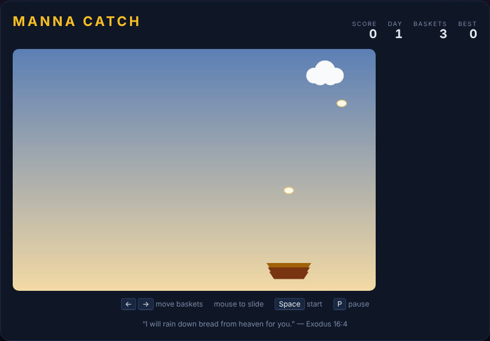

# Manna Catch

*"Then the Lord said to Moses, 'I will rain down bread from heaven for you.'"*
— Exodus 16:4

A catching reflex game, built with plain HTML5 canvas and JavaScript — no build
step, no dependencies. In the wilderness, God fed His people with manna every
morning. A cloud drifts across the sky raining down manna; you slide a stack of
woven baskets along the bottom to gather every flake before it touches the
ground. Miss a flake and it melts in the sun, taking a basket with it. Lose all
your baskets and the day is over.



## How to play

Open `index.html` in any modern browser. Press **Space** (or click **Start
Game**) to begin.

| Key | Action |
|---|---|
| ← / A | Move the basket stack left |
| → / D | Move the basket stack right |
| Mouse move | Slide the basket stack to the pointer |
| Space | Start / restart the game |
| P | Pause / resume |

- Catch a flake by lining the basket stack up underneath it before it drops past
  the catch line. Each flake is worth **`day`** points, so later days pay more.
- Catch **10 manna flakes** to clear a day. Clearing a day earns a **bonus basket**
  (up to 5) and speeds the cloud up while it drops manna flakes more often.
- Missing a single flake destroys a basket **and** melts every other flake on
  screen, resetting your progress toward the current day.
- You start with 3 baskets; when the last one is gone the game ends.
- Your best score is saved in the browser's `localStorage`.

## Development

Manna Catch follows the repo-wide test setup. From the repository root:

```powershell
npm install
npx playwright install chromium
npx playwright test MannaCatch/tests/
```

See [DESIGN.md](DESIGN.md) for how the code is structured and how the simulation
is made deterministic for testing.
