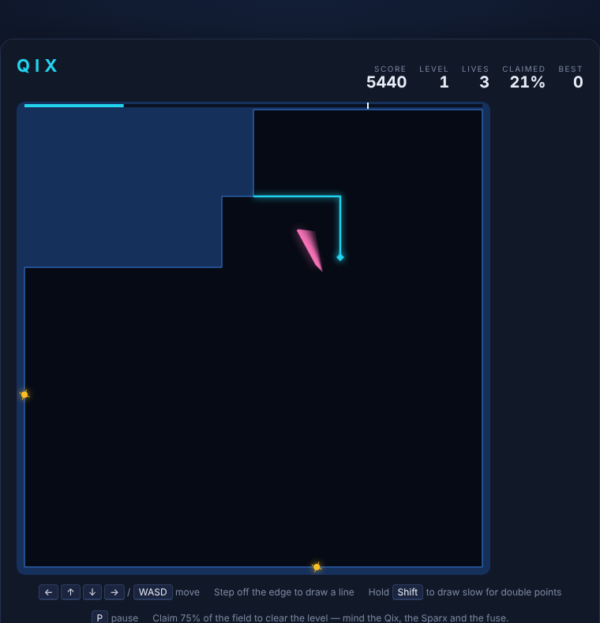

# Qix

Claim the field by fencing it off, one box at a time, while a tumbling line
creature and a pair of electric sparks try to stop you.



## How to play

You own the border of the field. Your marker walks along the edge of everything
you own. Step off that edge into the open middle and you start drawing a
**line**. The moment the line touches owned ground again, the area it has just
fenced off is filled in and becomes yours.

Claim **75%** of the field and the level is cleared.

Three things want to stop you:

- **The Qix** — the pink creature tumbling around the open middle. It cannot
  touch you while you are on the edge, but if it crosses the line you are
  drawing, you lose a life.
- **The Sparx** — the yellow sparks that patrol the edge of your territory and
  hunt you down. They cannot leave the edge, so the open middle is a refuge —
  but you have to get back out eventually.
- **The fuse** — stand still in the middle of a line and it lights at the point
  where you left the edge, then burns along your own line toward you. Keep
  moving and it stops where it is; close the loop and it goes out.

The side of the field the Qix is standing on is never claimed, so the game is
really about cutting it into a smaller and smaller pen.

## Scoring

| | |
|---|---|
| each cell claimed | 10 points |
| drawn slowly (hold Shift) | double |
| clearing a level | 1000 points |

Slow lines are worth twice as much and take twice as long to draw, which is
twice as long for the Qix to find them. That trade is the whole game.

Your best score is kept in the browser between sessions.

## Controls

| Input | Action |
|---|---|
| Arrow keys / WASD | move the marker |
| hold Shift (or Z) | draw slowly, for double points |
| Space / Enter | start, and continue between levels |
| P | pause |

Each level afterwards adds a Sparx (up to five) and a faster Qix.

## Running it

Open `index.html` in any browser — there is no build step and no server.

Tests:

```powershell
npx playwright test Qix/tests/
```

`DESIGN.md` explains how the code works.
