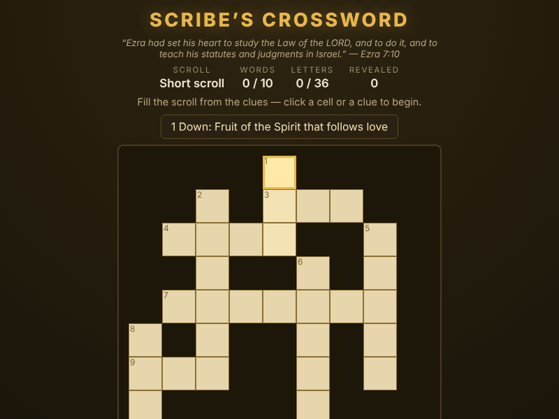

# Scribe's Crossword

*"Ezra had set his heart to study the Law of the LORD, and to do it, and to
teach his statutes and judgments in Israel."* — Ezra 7:10

A crossword where every answer comes out of the Bible — people like *Ruth* and
*Timothy*, places like *Sinai* and *Corinth*, books like *Genesis*, and things
like *manna*, *mustard* and the *armour* of God. Sit at the scribe's desk, read
the clues down the side, and fill the parchment.

Every scroll is built fresh when you open the page, so the puzzle is never the
same twice.



## How to play

Open `index.html` in any browser — no build step and no server.

1. Pick a scroll: **Short** (9×9), **Long** (11×11) or **Great** (13×13).
2. Read the clue in the banner above the grid, or click any clue in the Across
   and Down lists to jump to it.
3. Write the answer into the numbered cells. Letters shared between a word going
   across and a word going down are free help — fill one and the other gets a
   head start.
4. The scroll is finished the moment every cell holds the right letter.

### Controls

| Input | Action |
|---|---|
| Click a cell | Write there (click it again to turn across ↔ down) |
| Click a clue | Jump to the first cell of that entry |
| A–Z | Write a letter and step along the entry |
| Backspace / Delete | Rub out and step back |
| Arrow keys | Move one cell |
| Space | Turn across ↔ down |
| Tab / Shift+Tab | Next / previous clue |
| Esc | Put the pen down |
| On-screen keyboard | The same letters, for a tablet or phone |

Because every letter key writes into the grid, there are no single-letter
shortcuts: **Check**, **Reveal Letter**, **Reset** and **New Scroll** are
buttons.

- **Check** marks every wrong letter in red for a few seconds and says how many
  there are. It never fills anything in, so you can lean on it freely.
- **Reveal Letter** writes the right letter into the selected cell and counts a
  hint — the finish screen remembers how many you used.

## How it is built

Plain HTML5 canvas and JavaScript, no dependencies. The grid, the clue lists and
the interlocking rules are described in [DESIGN.md](DESIGN.md). Tests live in
`tests/` and run with the repository's Playwright suite:

```powershell
npx playwright test ScribesCrossword/tests/
```
