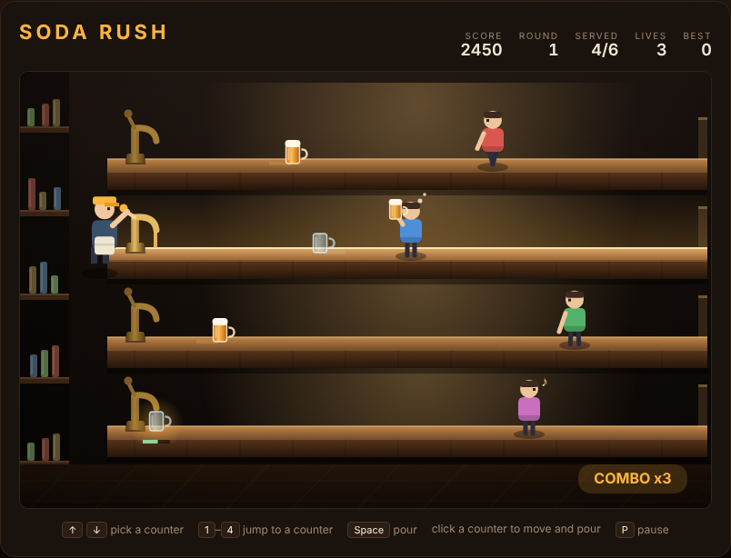

# Soda Rush

Four counters, one tap, and a bar filling up with thirsty customers. A
drink-slinging arcade game in the spirit of *Tapper*.

Open `index.html` in any browser — no build step, no server.



## How to play

You stand at the tap and you never leave it. Customers walk in from the open
end of each counter and head straight for you. Pick their counter, pull the
tap, and the mug slides out to meet them.

They drink, wander off satisfied — and send the empty mug sliding back down the
counter towards you. Be standing at *that* counter when it arrives, or it goes
over the end and smashes.

That is the whole juggle: full mugs going out, empty mugs coming back, and you
can only be on one counter at a time. An empty waits at the tap for most of a
second before it drops, which is just enough time to notice it and get there.

The `Cleared` counter in the HUD is the round's progress: how many customers
have left the counter, whether they left happy or walked off with your life.

Three things cost you a life:

- a customer reaches the tap
- a mug poured at an empty counter sails off the open end
- an empty mug is left at the tap until it tips over

Lose one and the counters are swept clear, the queue is shoved back, and your
combo goes with it.

## Controls

| Input | Action |
|---|---|
| `↑` `↓` or `W` `S` | move to the counter above / below |
| `1`–`4` | jump straight to a counter |
| `Space` / `Enter` | pour (and start, or restart after game over) |
| click a counter | move there and pour in one gesture |
| `P` | pause |

## Scoring

| Event | Points |
|---|---|
| Customer catches a mug | 50 |
| Customer leaves satisfied | 100 |
| Empty mug collected | 25 × combo |
| Round cleared | 300 × round number |

The combo climbs by one with every empty you collect and caps at ×5, so a clean
round is worth far more than a scrappy one. It resets to zero the instant you
lose a life. Your best score is remembered in the browser.

Rounds never run out: each one brings two more customers, walking a little
faster, arriving a little closer together, up to a ceiling that keeps the
late rounds hard rather than impossible.

## Tips

- Pouring is cheap, but a mug with nobody to catch it is a life. Only pour at a
  counter that has someone walking down it.
- One mug per customer. A second mug on the same counter sails past the person
  already drinking and smashes at the end.
- Watch the bar under a waiting empty — it turns red when the mug is about to
  go over.
- Empties are where the score is. Serving everyone while dropping the glasses
  scores barely a third of a clean round.

## Development

See `DESIGN.md` for the counter geometry, the customer and mug life cycles, and
the seeded round schedule. The Playwright suite lives in `tests/` and was
written before the implementation:

```powershell
npx playwright test SodaRush/tests/
```

Among its 89 specs are end-to-end ones that play the opening rounds to
completion with the real rules and a deliberately simple greedy strategy, so
the game can never regress into being unwinnable — or into being winnable while
standing still.
