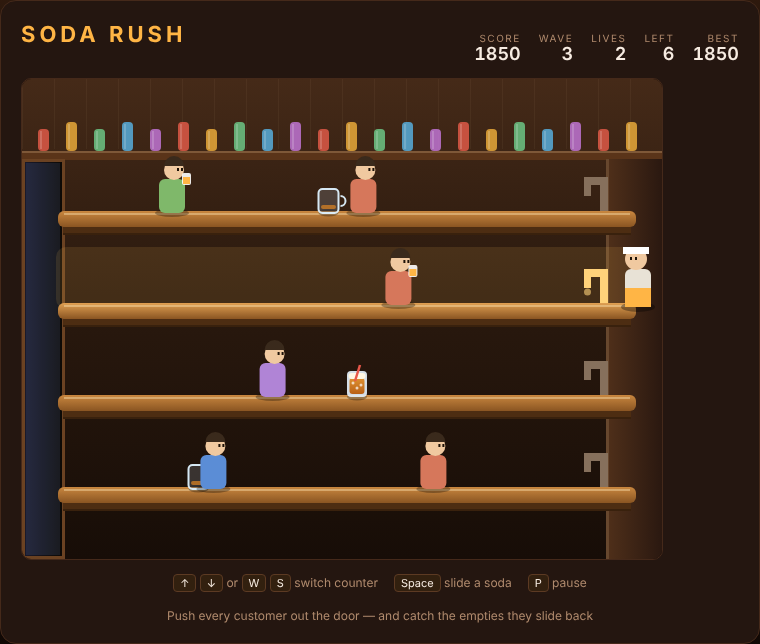

# Soda Rush

You are the only server on a four-counter soda bar, and everyone is thirsty.



## How to play

Customers walk in through the doors on the left and head towards the fountain
on the right, where you are standing. Slide a soda down a counter and the
customer nearest you is knocked back a few paces while they drink. Push them
past the doors and they leave happy — but they slide their empty glass straight
back at you, and an empty that reaches the fountain with nobody there hits the
floor.

- **Serve every customer before they reach you.** A customer that gets to the
  fountain end costs a life.
- **Catch the empties.** Stand at a counter and the glass sliding down it is
  caught automatically. Miss one and it smashes — another life.
- **Do not waste glasses.** A soda that runs the whole counter without reaching
  anybody spills and costs you 25 points — annoying, but never fatal.
- **Clear the wave.** Satisfy the wave's quota of customers for a bonus. Each
  wave brings customers in faster and makes them walk quicker.

Three lives. Your best score is remembered in the browser.

## Controls

| Input | Action |
|---|---|
| <kbd>↑</kbd> / <kbd>W</kbd> | Move up one counter |
| <kbd>↓</kbd> / <kbd>S</kbd> | Move down one counter |
| <kbd>Space</kbd> | Slide a soda (also starts and restarts the game) |
| <kbd>P</kbd> | Pause / resume |

## Scoring

| Event | Points |
|---|---|
| Customer served out of the door | +100 |
| Empty glass caught | +50 |
| Wave cleared | +250 × wave number |
| Soda spilled off the far end | −25 |

## Running it

Open `index.html` in any browser — no build step, no server, no assets.

## Tests

From the repository root:

```powershell
npx playwright test SodaRush/tests/
```

See [DESIGN.md](DESIGN.md) for how the code is put together.
