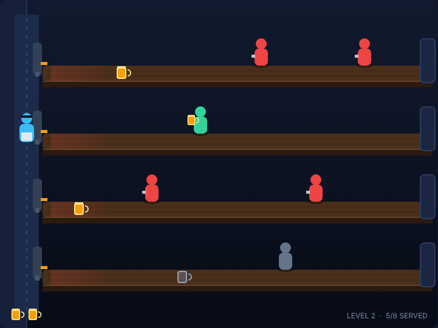

# Soda Slinger

Four counters, one soda jerk, and a bar full of people who will not wait. Slide
filled mugs down the counters, serve everybody before they reach the taps, and
catch every empty they shove back at you.



## How to play

Customers walk in from the far (right) end of each counter and shuffle toward
the taps on the left, where you work. Move between the four counters and pour:
the mug slides right and the frontmost customer on that counter catches it,
drinks, gets pushed back, then leaves — and shoves the empty mug back down the
counter at you. Be standing at that counter when the empty arrives.

You walk between the counters rather than teleporting, so a change of counter
costs about a third of a second — long enough that a busy counter and a
returning empty really do compete for you. Pouring while still on your way does
nothing; arrive first.

### Controls

| Input | Action |
|---|---|
| <kbd>↑</kbd> / <kbd>W</kbd> | move up one counter |
| <kbd>↓</kbd> / <kbd>S</kbd> | move down one counter |
| <kbd>Space</kbd> | pour and slide a mug (also starts the game) |
| click the canvas | pour a mug |
| <kbd>P</kbd> | pause / resume |

### Scoring

| Event | Points |
|---|---|
| Customer served | 50 |
| Empty mug caught | 10 |
| Level cleared | 100 × level |

### Losing a life

You have three lives. You lose one when:

* a customer reaches the taps without a drink,
* a filled mug runs off the far end with nobody to catch it, or
* an empty mug comes back to a counter you are not standing at.

Whichever counter the mistake happened on is cleared out, so one pile-up costs
one life and not three.

### Levels

Five levels. Each one asks for more customers and walks them in faster. Clear
all five and you win; the best score is kept in your browser via
`localStorage`.

## Running it

Open `index.html` in a browser, or play it from the game browser home page.

## Tests

The Playwright suite was written before the game and drives the simulation
directly:

```powershell
npx playwright test SodaSlinger/tests/
```

## Design notes

See [DESIGN.md](DESIGN.md) for the field geometry, the fixed-timestep
simulation, the scoring constants and the assumptions made while building it.
