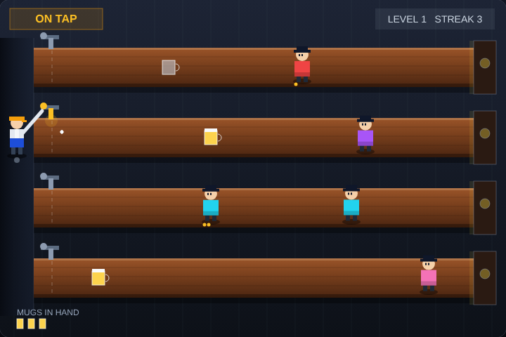

# Soda Tapper

A lane-based serving game on an HTML5 canvas. You are the only soda jerk
working four counters, and the bar is filling up.



## How to play

Patrons walk in from the door on the right and head steadily for your taps on
the left. Pour a soda and it slides down the counter; the patron who catches it
is shoved back towards the door and throws the empty mug straight back at you.

Shove a patron out of the door and they leave satisfied. Clear every arrival in
a shift and the next shift begins — more patrons, walking faster, arriving more
often.

### Controls

| Input | Action |
|---|---|
| `↑` / `W` | move up one counter |
| `↓` / `S` | move down one counter |
| `Space` / `Enter` | pour a soda (also starts or resumes the game) |
| `P` | pause / resume |
| Click a counter | jump to that counter and pour |

### Losing a life

You start with three lives. Each of these costs one, and clears the counter it
happened on:

- a patron reaches the taps,
- a soda runs the whole counter and smashes at the door (never pour at an empty
  counter),
- an empty mug arrives at a counter you are not standing at.

### Scoring

| Event | Points |
|---|---|
| Patron catches a soda | 50 |
| Empty mug caught | 100 |
| Patron leaves through the door | 250 |
| Tip collected | 500 |
| Shift cleared | 1000 × shift number |

Satisfied patrons sometimes leave a tip sliding back down the counter. Collect
it the same way you catch an empty — be standing there. Missing a tip costs
nothing but the points.

Your best score is kept in the browser's local storage.

## Strategy

The shove a soda delivers is a fixed distance, so *where* you serve a patron
decides how much work they are. Catch someone just inside the door and one or
two sodas see them out; let them walk the length of the counter and they need
four. The counter position is the difficulty.

The real constraint is the empty mug. Every soda you pour commits you to being
back at that counter when the empty returns, so pouring on two counters at once
is a promise you usually cannot keep. Serve one counter at a time, work the
counter whose patron is closest to your taps, and never pour speculatively.

## Running

Open `index.html` in any browser — no build step or server required.

## Tests

From the repository root:

```powershell
npx playwright test SodaTapper/tests/
```

## Design

See [DESIGN.md](DESIGN.md) for the geometry, the simulation model, the
difficulty curve and the assumptions behind them.
