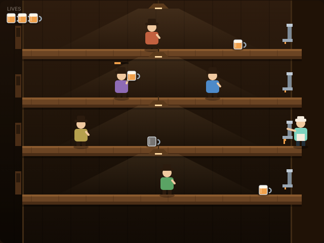

# Soda Tapper

Four counters, one server, and a queue of very thirsty customers. A single-screen
service-counter arcade game in the spirit of *Tapper* — built on an HTML5 canvas
with no build step and no server. Open `index.html` in any browser.



## How to play

Customers walk in at the far end of each counter and head straight for your
station. You cannot leave the station and you cannot stop them walking: the only
move you have is to slide a full mug down the counter to meet them.

A customer who gets a mug is shoved back down the counter and stops to drink.
Each finished drink sends an **empty mug sliding back at you** — be standing on
that counter when it arrives, or it smashes on the floor. Two drinks and the
customer heads home satisfied.

Three things cost you a life:

| What happened | Why |
|---|---|
| **Soda spilled** | a mug you poured found nobody and ran off the end |
| **Mug shattered** | an empty came back to a counter you were not on |
| **Grabbed!** | a customer made it all the way to your station |

So pour sparingly, and remember that every mug you pour is an empty you will
have to come back for. A lost life clears the bar, but the customers you never
served go back into the queue — the shift still has to be worked in full.

Clear the whole wave to finish the level, bank a `200 x level` bonus, and start
a longer, faster shift.

## Controls

| Input | Action |
|---|---|
| `↑` / `W` | move up one counter |
| `↓` / `S` | move down one counter |
| `Space` | pour a mug (also starts and resumes) |
| `P` | pause |
| Click the canvas | pour |

## Scoring

| Event | Points |
|---|---|
| Mug taken by a customer | 25 |
| Empty mug caught | 10 |
| Customer served and gone | 100 |
| Level cleared | 200 x level |

The best score is kept in `localStorage`.

## Files

| File | What it holds |
|---|---|
| `index.html` | page shell, canvas, HUD and overlay |
| `style.css` | the arcade cabinet styling |
| `game.js` | all state, simulation and drawing |
| `DESIGN.md` | how the code works, and the assumptions behind it |
| `tests/sodatapper.spec.js` | the Playwright suite |

## Tests

From the repository root:

```powershell
npx playwright test SodaTapper/tests/
```
