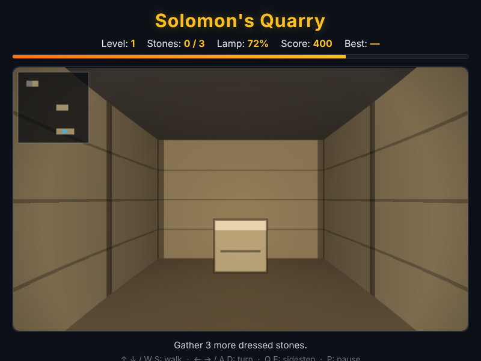

# Solomon's Quarry

*"In building the temple, only blocks dressed at the quarry were used, and no
hammer, chisel or any other iron tool was heard at the temple site while it was
being built."* — 1 Kings 6:7

A first-person maze game by lamplight, drawn on a plain HTML5 `<canvas>` with a
raycasting engine — no build step, no server, no dependencies. You are one of
Solomon's quarry workers, deep under the hill. The dressed stones for the temple
are waiting at the far ends of the tunnels, your lamp holds only so much oil,
and the way out is the quarry mouth you came in by.

There is nothing down here to fight. The pressure is the oil and the dark.



## How to play

Open `index.html` in any browser, then press **Space** (or click **Start Game**).

1. Walk the tunnels and collect every **dressed stone** — they lie in the dead
   ends, as far from the mouth as the quarry allows.
2. Pick up **oil flasks** on the way; each one puts 25% back in the lamp.
3. When the last stone is yours the **gate at the quarry mouth opens** and glows.
   Walk back onto it to clear the level.
4. Five levels, each a bigger quarry than the last. Clear level 5 and the stones
   are up at the temple.

The lamp is both your clock and your light: as the oil burns down the tunnels
close in around you. Let it go out and the run is over.

### Controls

| Input | Action |
|---|---|
| **↑** / **W** | walk forward |
| **↓** / **S** | walk back |
| **←** **→** / **A** **D** | turn left / right |
| **Q** / **E** | sidestep left / right |
| **P** | pause / resume |
| **Space** / **Enter** | start a run, or play again when it ends |

### Scoring

| Event | Points |
|---|---|
| Dressed stone | 100 |
| Level cleared | 250 + the oil left in the lamp |

Your best score is saved in the browser between visits.

## Finding your way

The **minimap** in the top-left corner fills in only as you walk — it shows the
tunnels you have already been down, the stones you have seen and not yet
collected, and the quarry mouth, which turns gold once the gate opens. Nothing
is revealed before you walk it, so the map is a record of where you have been,
not a solution.

Add `?seed=123` to the URL to play a quarry you can come back to: the same seed
always carves the same tunnels.

## How it is built

* `index.html` — markup, HUD and the overlay.
* `style.css` — the lamplit colour scheme.
* `game.js` — maze generation, movement, the lamp, and the raycasting renderer.
* `tests/solomons-quarry.spec.js` — 68 Playwright tests, written before the game.
* `DESIGN.md` — how the engine works, and the assumptions behind the design.

Run the tests from the repository root:

```powershell
npx playwright test SolomonsQuarry/tests/
```
