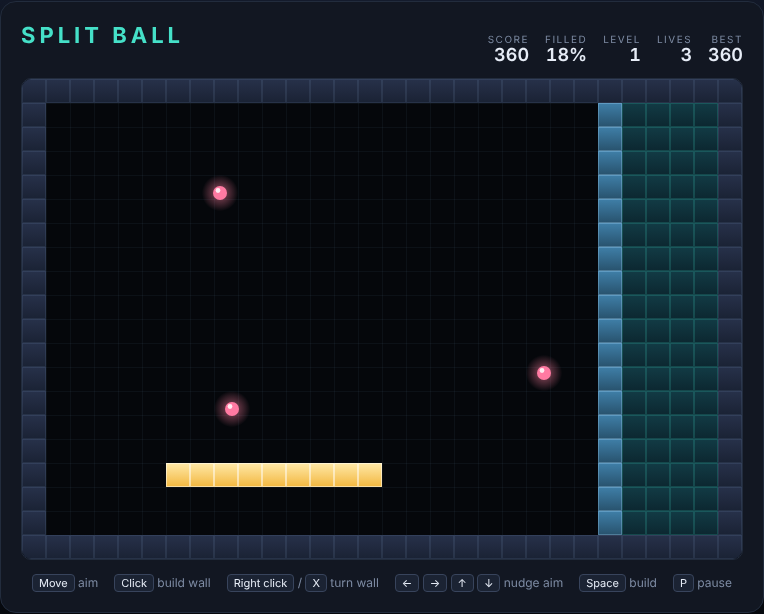

# Split Ball

Fence the bouncing balls into a corner. You have no avatar and no weapon — only
walls, and the nerve to start one at the right moment.

Open `index.html` in any browser — no build step, no server.



## How to play

The arena starts as one open room with two balls loose in it. Aim at any open
cell and build: a wall sprouts there and grows in **both** directions at once
until each end hits something solid.

The instant it lands, the room is cut in two, and any sealed-off piece with no
ball left in it collapses into solid territory — that is your score.

A wall is only vulnerable while it is growing. Touch it with a ball and the
whole thing shatters and costs you a life. Territory you already captured is
safe; you lose the wall, not the level.

Fill **75%** of the arena to clear it. Each new level adds another ball and a
little more speed, and your lives carry over.

The cheapest captures are the ones you take early, while the room is wide and
the balls are far apart. The hard ones come later, when four balls are rattling
around a thin strip and every wall is a coin flip.

## Controls

| Input | Action |
|---|---|
| Mouse move | aim — the dashed line shows exactly how far the wall will reach |
| Left click | build the wall |
| Right click or `X` | turn the wall vertical ⇄ horizontal |
| `←` `→` `↑` `↓` | nudge the aim cursor one cell (keyboard play) |
| `Space` | start, continue, and build while playing |
| `P` | pause |

## Scoring

| Event | Points |
|---|---|
| Each captured cell | 5 |
| Clearing a level | 250 × level |

Your best score is kept in the browser's local storage.

## Tests

```powershell
npx playwright test SplitBall/tests/
```

68 Playwright specs cover ball physics and bouncing, wall growth and
frame-rate independence, region capture, wall shattering, lives, level clear,
pausing and every input path. The game exposes `step(dt)` and an `autoStep`
flag, so the suite advances the simulation itself and never sleeps.

`DESIGN.md` explains how the code works.
