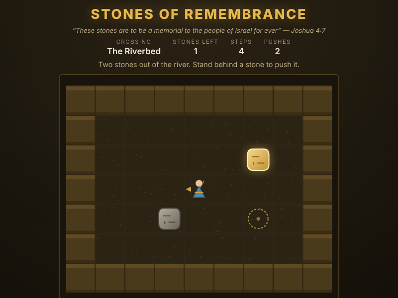

# Stones of Remembrance

*"Take twelve stones from the middle of the Jordan... These stones are to be a
memorial to the people of Israel for ever."* — Joshua 4:3, 7

A stone-pushing puzzle in the bed of the Jordan. Israel crossed over on dry
ground, and twelve men each carried a stone up out of the riverbed to set up at
Gilgal, so that when later generations asked what the stones meant, the crossing
would be told again. You are one of the bearers: walk the dry bed and push every
stone onto a memorial place.



## How to play

Open `index.html` in any browser — no build step or server required.

Walk the bearer with the **arrow keys** or **WASD**. Walking into a stone pushes
it one square, if the square behind it is clear. Finish a crossing by getting
every stone onto a **memorial place** — the dashed gold rings scratched into the
riverbed. A stone standing on its place glows gold.

The rules are the push-only ones:

- You can **push** a stone but never **pull** it, so you have to walk round to
  the far side of a stone to move it the way you want.
- You can only move **one stone at a time**. A stone will not budge if a wall or
  another stone is directly behind it.
- A stone shoved into a corner is **wedged for good**. The game says so, and the
  stone is outlined in red — press **U** to take the push back.

| Input | Action |
|---|---|
| Arrow keys / WASD | Walk one square, pushing whatever is in front of you |
| Click a square | Step one square towards it (same row or column) |
| U | Undo the last step |
| R | Reset this crossing |
| N | Next crossing, once this one is finished |

The **Undo**, **Reset** and **Next Crossing** buttons do the same, and the
numbered buttons jump straight to any crossing.

## The five crossings

| # | Crossing | Stones | Fewest pushes |
|---|---|---|---|
| 1 | The Riverbed | 2 | 5 |
| 2 | Dry Ground | 3 | 6 |
| 3 | The Crossing | 3 | 11 |
| 4 | Gilgal | 4 | 19 |
| 5 | The Memorial | 4 | 25 |

Every one can be finished — the test suite proves it by solving each map with
its own independent solver, and checks that each crossing needs more pushes than
the one before.

## Testing

From the repository root:

```powershell
npx playwright test StonesOfRemembrance/tests/
```

See [DESIGN.md](DESIGN.md) for how the code is put together.
