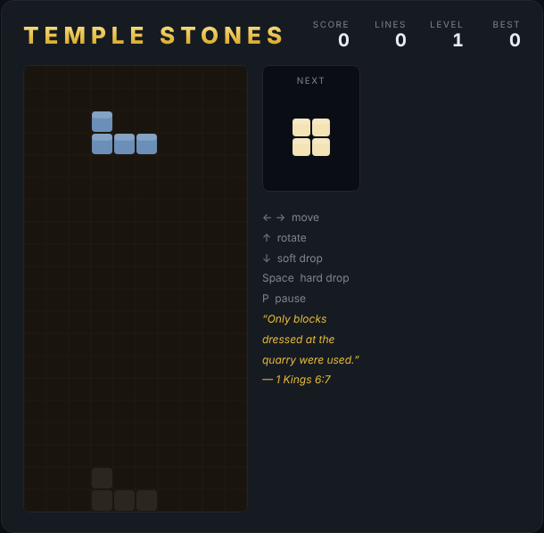

# Temple Stones

*"In building the temple, only blocks dressed at the quarry were used, and no
hammer, chisel or any other iron tool was heard at the temple site."* — 1 Kings 6:7

A falling-block puzzle themed on the building of Solomon's temple, built with
plain HTML5 canvas and JavaScript — no build step, no dependencies. The stones
arrive already cut to shape; slide and rotate them so they fit together into
complete courses. Each finished course is set in place, scoring points and
raising the level, while you stay ahead of the rising pile.



## How to play

Open `index.html` in any modern browser. Press any arrow key or **Space** (or
click **Start Game**) to begin.

| Key | Action |
|---|---|
| ← / → | Move the piece left / right |
| ↑ | Rotate clockwise |
| ↓ | Soft drop (fall one row, +1 point) |
| Space | Hard drop (slam to the bottom and lock) |
| P | Pause / resume |

- Clear **1 / 2 / 3 / 4** rows at once for **100 / 300 / 500 / 800** points,
  multiplied by your current level.
- Every 10 cleared lines raises the level and speeds up the drop.
- A translucent **ghost** shows where the current piece will land.
- Your best score is saved in the browser's `localStorage`.

The game ends when a new piece can no longer fit at the top of the well.

## Development

Temple Stones follows the repo-wide test setup. From the repository root:

```powershell
npm install
npx playwright install chromium
npx playwright test TempleStones/tests/
```

See [DESIGN.md](DESIGN.md) for how the code is structured.
