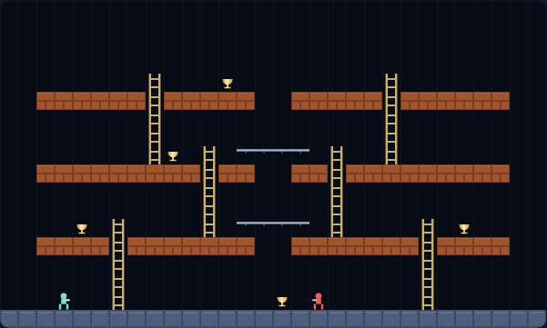

# Temple Vessels

*"King Cyrus brought out the articles belonging to the temple of the Lord, which
Nebuchadnezzar had carried away from Jerusalem."* — Ezra 1:7

A grid platformer about carrying the golden vessels of the temple home from
Babylon's storehouses past a guard patrol, built with plain HTML5 canvas and
JavaScript — no build step, no dependencies. You cannot jump and you cannot
fight. What you *can* do is **dig**: open the brick beside your feet and leave a
hole for a guard to fall into, then sprint across its head while it climbs out.

Recover every vessel and the hidden ladders light up. Climb to the top of the
screen and you are on the road home.



## How to play

Open `index.html` in any modern browser. Press **Space** (or click **Start
Game**) to begin.

| Key | Action |
|---|---|
| ← / → (or A / D) | Run left / right |
| ↑ / ↓ (or W / S) | Climb a ladder, or drop off a bar |
| Z (or `,`) | Dig down-left |
| X (or `.`) | Dig down-right |
| Space | Start / restart the game |
| P / Esc | Pause / resume |

- **Temple vessels** are recovered by running over them. Take every one and the
  hidden ladders
  down the side walls become climbable — reach the **top row** to clear the level.
- **Digging** only works on plain brick — the reddish blocks — and only from firm
  footing, never from a ladder or a bar. Grey stone cannot be dug.
- A hole **fills itself back in after five seconds**, flashing before it closes. A
  guard still in it is buried and respawns at its post — and so are you, if you
  are standing in your own hole.
- A trapped guard is solid ground: you can run straight over its head.
- Touching an untrapped guard costs a life. You have three; the score and the gold
  you already banked survive a death.
- Three levels, then you are home in Jerusalem for good. Your best score is saved in the
  browser's `localStorage`.

### Scoring

| Event | Points |
|---|---|
| Temple vessel | 100 |
| Guard trapped | 50 |
| Guard buried | 100 |
| Level cleared | 500 + 100 per life left |

## Development

Temple Vessels follows the repo-wide test setup. From the repository root:

```powershell
npm install
npx playwright install chromium
npx playwright test TempleVessels/tests/
```

See [DESIGN.md](DESIGN.md) for how the code is structured, how the level maps are
written, and how the simulation is kept deterministic for testing.
