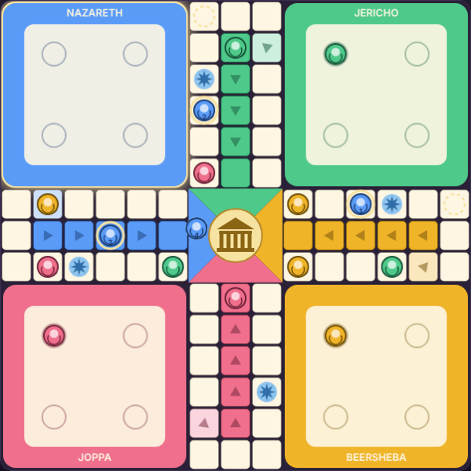

# Up to Jerusalem

*"I rejoiced with those who said to me, 'Let us go to the house of the LORD.'"*
— Psalm 122:1

Four pilgrim families set out from Nazareth, Jericho, Beersheba and Joppa and
race up to Jerusalem for the feast, as Joseph and Mary "went to Jerusalem every
year at the Feast of the Passover" (Luke 2:41). Each family has four pilgrims
waiting at home. The die sends them out onto the pilgrim road, round the land
and up the ascent into the temple courts. The first family to gather all four
pilgrims in the temple keeps the feast.

You travel with the blue family from **Nazareth**; the other three families are
played by the computer.



## How to play

Open `index.html` directly in a browser — no build step or server needed.

### Controls

| Action | Input |
|---|---|
| Start a game / roll the die | **Space**, **Enter**, or the **Roll** button |
| Move a pilgrim | **click** it, or **1**–**4**, or **Enter** for the first move |
| New game | **N**, or the **New Game** button |

Pilgrims you may move are ringed in gold, and a dashed ghost marks where each
one would land — pink when the move sends another family's pilgrim home.

### Rules

- A pilgrim leaves home only on a **six**, stepping onto your family's start
  cell. Rolling a six earns another roll.
- The die says how far **one** pilgrim walks; you choose which one.
- Land on a cell holding a **lone** pilgrim of another family and that pilgrim
  goes back to its home town — and you roll again.
- A pilgrim cannot be sent home while it stands on a **start cell**, on one of
  the four **wells** (the blue stars), or beside a companion of its own family.
- Two pilgrims of one family may camp on a cell together; other families may
  still walk past them.
- Three sixes in a row and the turn passes on, so a run of luck cannot stall
  the game.
- The last five cells before the centre are your family's private **ascent**,
  where no one can touch you. The **temple** must be reached by an exact roll —
  a bigger number simply cannot be used.
- The first family with all four pilgrims in the temple wins. Feasts you win
  are remembered in your browser.

## Strategy

- A pilgrim within six cells ahead of an opponent is in danger. The wells and
  start cells are the only shelter on the open road.
- Setting out early gives you choices later; four pilgrims still at home means
  every six is spent just getting onto the road.
- Two pilgrims on one cell are safe from capture, which makes a camp a good
  place to pause while you wait for the right roll.
- Count before you move: a pilgrim one cell short of the temple needs an exact
  **1**, and every other roll is wasted on it.

## Files

| File | What it holds |
|---|---|
| `index.html` | Page layout, the HUD, the family panel and the rules |
| `style.css` | Styling for the page, the overlay and the family panel |
| `game.js` | Board geometry, the rules, the computer players and all drawing |
| `DESIGN.md` | How the code is put together, and the assumptions made |
| `tests/` | The Playwright suite, written before the game |

## Tests

From the repository root:

```powershell
npx playwright test UpToJerusalem/tests/
```

The suite checks the board geometry, every rule, the mouse and keyboard
controls, and plays whole games through to a winner to prove the computer
families never leave the board in an illegal state.
